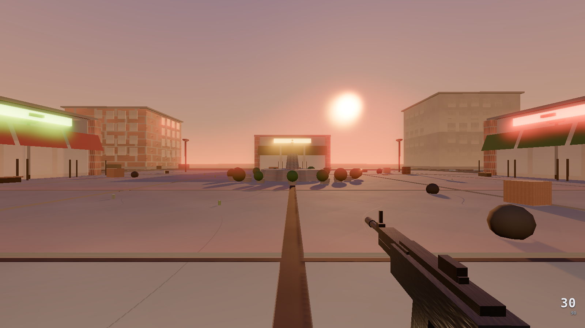

# CS- — browser FPS projects

Two first-person shooters built on [Three.js](https://threejs.org/), with no
art assets: every texture, mesh and sound is generated in code.

| Project | What it is | Stack | Status |
|---|---|---|---|
| [`overwatch/`](overwatch/) | **OVERWATCH** — a single-map FPS aiming for modern-shooter visual quality (HDR, bloom, AgX tone mapping, soft shadows, time of day). | JavaScript, Vite, Three.js r180 | Builds and runs; deployed by the root `netlify.toml` |
| [`stride-ops/`](stride-ops/) | **STRIDE OPS** — an "AI-native" FPS engine with Classic, AI-Director and Creator modes, procedural maps across 6 biomes, squad AI. | TypeScript, webpack, Jest, Three.js r162 | Builds, type-checks clean, 276 tests passing |



## OVERWATCH

```bash
cd overwatch
npm install
npm run dev        # http://127.0.0.1:5173
npm run build      # -> overwatch/dist/
npm test           # shared gameplay tests (Node built-in runner, no deps)
```

Controls: click to lock the mouse, **WASD** move, **Shift** sprint, **Space**
jump, **R** reload, **Q/E** lean, **F** interact, **G** use, **X** inspect,
**1 / 2** or the **mouse wheel** switch between your main weapon and pistol,
**B** opens the buy menu, **Esc** opens the game menu.

**Settings** (start menu tab, or Esc → Settings): mouse sensitivity, invert
mouse Y, field of view, volume, graphics quality and an FPS overlay. They're
saved in your browser and apply immediately, except graphics quality, which
needs a reload (the panel offers one). URL parameters such as `?sens=`,
`?fov=` and `?q=` still override them.

Weapons: Pistol (free, everyone has one), Heavy Pistol ($700), SMG ($1,250),
Assault Rifle ($2,700) and Sniper Rifle ($4,750, right-click to scope). In
single player everything in the buy menu is free.

URL options: `?q=low|medium|high|ultra` (quality), `?time=day|golden|dusk|night`,
`?seed=<n>`, `?debug`.

Engine rules for contributors are in [`overwatch/ARCHITECTURE.md`](overwatch/ARCHITECTURE.md).

**Screenshot checks.** Both need Chrome or Chromium (set `CHROME_PATH` if it
is not in a standard location) and a running dev server.
- Regression against the committed baselines: `npm run shotset && npm run imagediff`
  captures 7 fixed camera shots and compares them pixel-for-pixel with
  `overwatch/shots/baseline/`.
- Determinism: `npm run gate` re-captures the baselines, captures again and
  diffs the two runs. It overwrites `shots/baseline/`, so don't commit those
  files after a gate run unless the visual change is intended.

### Multiplayer (team rounds or deathmatch)

```bash
cd overwatch
npm install          # also installs the server workspace (ws)
npm run server       # ws://localhost:8787 (PORT, HOST, SEED env vars)
npm run dev          # in a second terminal
```

Open `http://127.0.0.1:5173/?server=ws://localhost:8787&name=alice` in two
windows (change `name`; add `&room=<name>` for a private room). Rooms play
**team rounds** by default; add `&mode=dm` when creating a room for
free-for-all deathmatch. Hold **Tab** for the scoreboard.

How a team match works:
1. Players are auto-balanced into **ALPHA** (orange) and **BRAVO** (blue),
   each spawning on its own side of the plaza. There's no friendly fire:
   bullets pass through teammates.
2. **Warmup** (free play, respawns on) lasts until both teams have a player.
3. Each round starts with a 3-second **freeze** at the team spawns. Then
   it's **live** for up to 1:55, with no respawns. Eliminate the other team
   to win, or have more players alive when time runs out (equal numbers is a
   draw).
4. First to **8 rounds** wins the match. The result and scoreboard show for
   10 seconds, then a fresh match starts.
5. Anyone joining mid-round sits out until the next round.

To play across two PCs on one network, run the server on one of them, start
the game with `npm run dev -- --host` so other machines can load it, and use
`?server=ws://<that PC's LAN IP>:8787` on both (allow port 8787 and 5173 in
the firewall).

Works now:
- Rooms of up to 10 players, with movement decided by the server. Your own
  movement is predicted, so it feels instant, and other players are smoothed.
- Shooting decided by the server, with lag compensation: a shot hits where
  you saw the target, up to 400 ms back.
- Damage depends on the weapon: the rifle does 34 to the body (three hits
  kill) and 100 for a headshot; the sniper kills with one hit anywhere. In
  deathmatch and warmup you respawn after 3 s at the spawn point farthest
  from enemies, with full ammo.
- Money and buying, like Counter-Strike. A team match starts everyone on
  the free pistol with $800. Kills pay $300 ($600 with the SMG, $100 with
  the sniper). Winning a round pays $3,250; losing pays $1,400, plus $500
  for each further loss in a row (at most $3,400). Press **B** to buy
  during the 6 s freeze and the first 20 s of the round, near your team's
  spawn; the timer shows under your money. A weapon bought this round can
  be sold back for its full price until buy time ends. If you survive the
  round you keep your weapons; if you die you start the next round with the
  pistol. Warmup and deathmatch give you a rifle and make buying free.
- The server enforces fire rate, ammo, reloads, weapon switches, purchases
  and where a shot can come from, so a modified client can't fire faster,
  skip reloads, use a weapon it didn't pay for or shoot from somewhere it
  isn't.
- Hitmarkers appear only for hits the server confirms. There's a kill feed
  for every kill in the room, and dead players lie down.
- AI enemies are switched off online.

- Other players are full soldier models in their team colour (or their own
  colour in deathmatch). They walk, crouch, aim up and down, and fall when
  killed, and you hear their gunfire (each weapon sounds different) and
  footsteps from where they are.

**Not yet:** a bomb objective, armour and grenades. Other players are drawn
holding a rifle whatever they carry (you still hear their real weapon).

### Hosting a match online

The server can also serve the game page, so one deploy gives one link that
you and your friends open: the page connects back to the server that served
it, and there's nothing else to set up.

```bash
cd overwatch
npm run build        # the game page, into dist/
npm start            # http://localhost:8787/ serves the game and the server
```

To put it on the internet, use any host that runs Node or containers and
supports WebSockets:
- **Render** (free tier): New → Blueprint → pick this repository. It reads
  `render.yaml` and the game is at `https://<service>.onrender.com/`. Free
  services sleep when idle, so the first visit after a while takes about a
  minute to wake up.
- **Fly.io, Railway or a VPS:** build `overwatch/Dockerfile` (`docker build
  -t overwatch overwatch && docker run -p 8787:8787 overwatch`).

The host provides the `PORT` variable and https. An https page connects
over `wss://` automatically. The health check is at `/health`.

To host the page somewhere else (Netlify, itch.io) and the server on its
own, build the page with the server's address baked in:
`VITE_SERVER_URL=wss://<your server> npm run build`. For itch.io, zip the
contents of `dist/` and upload it as an HTML game. The address field in the
menu can always point to a different server.

Local and LAN play over `ws://` work from `npm run dev`.

`npm test` covers the shared gameplay and the server: rebuilding the
browser's map from the seed, movement and bullets matching traces recorded
from the original game bit for bit, client prediction landing exactly on the
server's state, the anti-speed-hack limit, all the combat rules including
lag compensation, the whole round and match flow, and real WebSocket
clients moving and fighting.

Known behaviours the multiplayer work still has to account for:
- Falling is instant: the mover snaps the player onto the highest surface
  below them, so drops and the 60 m spawn land in one step.
- The plaza has no edge walls. Walking or jumping off it is a death (feet
  below y = -20): no kill credit online, and it counts toward a team
  elimination. The arena has walls all round.
- Collision resolves overlap instead of sweeping, so the server must only
  apply small per-step moves. It does: clients send inputs, never positions.

## STRIDE OPS

```bash
cd stride-ops
npm install
npm test               # 25 suites, 276 tests
npm run typecheck      # strict tsc, no output
npm run demo:dev       # http://localhost:8080
npm run demo:build     # -> stride-ops/dist-demo/
```

Launch straight into a mode with `?mode=classic`, `?mode=ai` or `?mode=creator`.
Full documentation: [`stride-ops/README.md`](stride-ops/README.md), plus the
design docs in [`stride-ops/docs/`](stride-ops/docs/).

## Repository layout

```
overwatch/     Vite + JS game: src/, shared/ (client+server gameplay), server/
               (multiplayer server), tests/, tools/ (capture, imagediff),
               shots/baseline/, Dockerfile (game page + server in one container)
stride-ops/    TypeScript engine: src/, tests/, demo/, docs/, webpack + jest config
netlify.toml   deploys overwatch/ (stride-ops/netlify.toml deploys the other)
render.yaml    hosts overwatch/ online: game page + multiplayer server
```

Build output (`dist/`, `dist-demo/`) and `node_modules/` are not committed;
rebuild them with the commands above.
